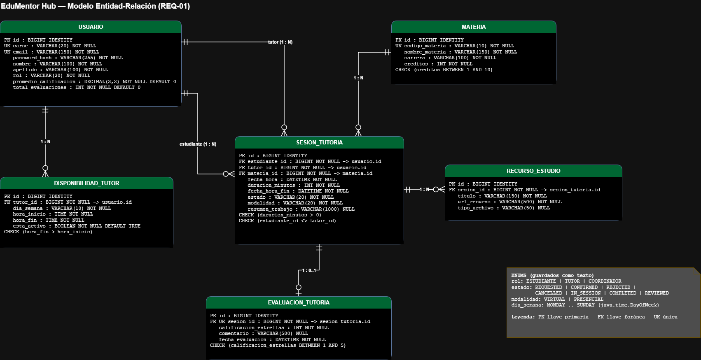

# Modelo Entidad-Relación // REQ-01 : Dev 1

Fuente editable: `diagrama-erd.drawio` · Versión PDF: `diagrama-erd.pdf`

## Decisiones de diseño: 

1. Estudiante y tutor son roles de `usuario`, no entidades. `sesion_tutoria` referencia a `usuario` dos veces (`estudiante_id` y `tutor_id`).
2. Enums guardados como texto (`@Enumerated(EnumType.STRING)`):
   - `rol`: ESTUDIANTE, TUTOR, COORDINADOR
   - `estado`: REQUESTED, CONFIRMED, REJECTED, CANCELLED, IN_SESSION, COMPLETED, REVIEWED
   - `modalidad`: VIRTUAL, PRESENCIAL
   - `dia_semana`: MONDAY a SUNDAY (`java.time.DayOfWeek`)
3. Promedio del tutor en `usuario`: `promedio_calificacion DECIMAL(3,2) NOT NULL DEFAULT 0` y `total_evaluaciones INT NOT NULL DEFAULT 0`, para recalcular el promedio de forma incremental sin releer todas las evaluaciones.
4. `fecha_hora_fin` en `sesion_tutoria`, calculada como `fecha_hora + duracion_minutos`; simplifica la detección de traslapes.
5. `resumen_trabajo` en `sesion_tutoria` (`VARCHAR(1000)`, admite NULL): lo registra el tutor al finalizar la sesión (estado COMPLETED).
6. Sin tabla intermedia tutor-materia: un tutor puede atender cualquier materia.
7. Relaciones `@ManyToOne` con `FetchType.LAZY`; los listados usan `@EntityGraph` o `JOIN FETCH` para evitar N+1.

## Tipos y longitudes

| Tabla | Columna | Tipo | Nulidad / default |
|---|---|---|---|
| usuario | id | BIGINT IDENTITY | PK |
| usuario | carne | VARCHAR(20) | NOT NULL, UNIQUE |
| usuario | email | VARCHAR(150) | NOT NULL, UNIQUE |
| usuario | password_hash | VARCHAR(255) | NOT NULL |
| usuario | nombre / apellido | VARCHAR(100) | NOT NULL |
| usuario | rol | VARCHAR(20) | NOT NULL |
| usuario | promedio_calificacion | DECIMAL(3,2) | NOT NULL DEFAULT 0 |
| usuario | total_evaluaciones | INT | NOT NULL DEFAULT 0 |
| materia | codigo_materia | VARCHAR(10) | NOT NULL, UNIQUE |
| materia | nombre_materia | VARCHAR(150) | NOT NULL |
| materia | carrera | VARCHAR(100) | NOT NULL |
| materia | creditos | INT | NOT NULL |
| disponibilidad_tutor | tutor_id | BIGINT | NOT NULL, FK → usuario.id |
| disponibilidad_tutor | dia_semana | VARCHAR(10) | NOT NULL |
| disponibilidad_tutor | hora_inicio / hora_fin | TIME | NOT NULL |
| disponibilidad_tutor | esta_activo | BOOLEAN | NOT NULL DEFAULT TRUE |
| sesion_tutoria | estudiante_id / tutor_id | BIGINT | NOT NULL, FK → usuario.id |
| sesion_tutoria | materia_id | BIGINT | NOT NULL, FK → materia.id |
| sesion_tutoria | fecha_hora / fecha_hora_fin | DATETIME | NOT NULL |
| sesion_tutoria | duracion_minutos | INT | NOT NULL |
| sesion_tutoria | estado / modalidad | VARCHAR(20) | NOT NULL |
| sesion_tutoria | resumen_trabajo | VARCHAR(1000) | NULL |
| recurso_estudio | sesion_id | BIGINT | NOT NULL, FK → sesion_tutoria.id |
| recurso_estudio | titulo | VARCHAR(150) | NOT NULL |
| recurso_estudio | url_recurso | VARCHAR(500) | NOT NULL |
| recurso_estudio | tipo_archivo | VARCHAR(50) | NULL |
| evaluacion_tutoria | sesion_id | BIGINT | NOT NULL, UNIQUE, FK → sesion_tutoria.id |
| evaluacion_tutoria | calificacion_estrellas | INT | NOT NULL |
| evaluacion_tutoria | comentario | VARCHAR(500) | NULL |
| evaluacion_tutoria | fecha_evaluacion | DATETIME | NOT NULL |

> Las longitudes de este ERD son el contrato para las entidades JPA (`length`, `precision` y `scale` en `@Column`) del resto de los REQ.

## Restricciones

| Tabla | Restricción |
|---|---|
| usuario | UNIQUE (carne), UNIQUE (email) |
| materia | UNIQUE (codigo_materia), CHECK (creditos BETWEEN 1 AND 10) |
| disponibilidad_tutor | CHECK (hora_fin > hora_inicio) |
| sesion_tutoria | CHECK (duracion_minutos > 0), CHECK (estudiante_id <> tutor_id) |
| evaluacion_tutoria | UNIQUE (sesion_id), CHECK (calificacion_estrellas BETWEEN 1 AND 5) |

## Cardinalidades

| Relación | Cardinalidad |
|---|---|
| usuario (tutor) → disponibilidad_tutor | 1 : N |
| usuario (estudiante) → sesion_tutoria | 1 : N |
| usuario (tutor) → sesion_tutoria | 1 : N |
| materia → sesion_tutoria | 1 : N |
| sesion_tutoria → recurso_estudio | 1 : N |
| sesion_tutoria → evaluacion_tutoria | 1 : 0..1 |