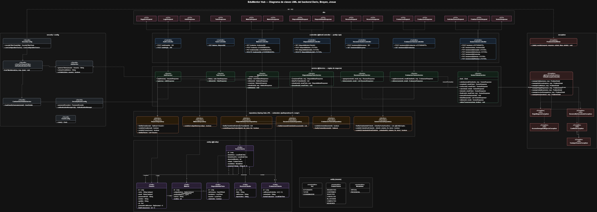

# Diagrama de clases UML del backend (REQ-02)

Diagrama de clases de EduMentor Hub organizado por capas. Los nombres de clases, atributos y métodos coinciden con el código de `src/main/java/cr/ac/ucr/edumentorhub`.



Archivos de esta carpeta:

| Archivo | Uso |
|---|---|
| `diagrama-clases.drawio` | Fuente editable (draw.io / diagrams.net) |
| `diagrama-clases.drawio.png` | Imagen del diagrama |
| `diagrama-clases.pdf` | Versión para imprimir |

## Capas

La dependencia va siempre en un solo sentido: `Controller → Service → Repository → Entity`.

| Capa | Paquete | Clases |
|---|---|---|
| Controladores | `controller` | `AuthController`, `MateriaController`, `TutorController`, `DisponibilidadController`, `SesionTutoriaController`, `RecursoEstudioController`, `EvaluacionTutoriaController` |
| Servicios | `service` | `AuthService`, `MateriaService`, `TutorService`, `DisponibilidadTutorService`, `SesionTutoriaService`, `RecursoEstudioService`, `EvaluacionTutoriaService`, `UsuarioActualService` |
| Repositorios | `repository` | `UsuarioRepository`, `MateriaRepository`, `DisponibilidadTutorRepository`, `SesionTutoriaRepository`, `RecursoEstudioRepository`, `EvaluacionTutoriaRepository` (Spring Data JPA) |
| Entidades | `entity` | `Usuario`, `Materia`, `DisponibilidadTutor`, `SesionTutoria`, `RecursoEstudio`, `EvaluacionTutoria`, y los enums `Rol`, `EstadoTutoria`, `Modalidad` |
| DTO y mapeo | `dto`, `mapper` | Un `Request` y un `Response` por recurso, y un `Mapper` que convierte entidad y DTO. Los controladores nunca exponen entidades. |
| Seguridad y configuración | `security`, `config` | `SecurityConfig`, `JwtAuthenticationFilter`, `JwtService`, `CustomUserDetailsService`, `SecurityBeansConfig`, `ClockConfig` |
| Excepciones | `exception` | `GlobalExceptionHandler` (RFC 7807), `ProblemDetailWriter`, `RecursoNoEncontradoException` (404), `ReglaNegocioException` (422), `AccesoDenegadoNegocioException` (403), `ConflictoException` (409) y `TraslapeHorarioException` (409, hija de `ConflictoException`) |

## Relaciones principales

### Entre entidades
- `SesionTutoria` referencia a dos `Usuario` (el **estudiante** y el **tutor**) y a una `Materia`. Son relaciones `@ManyToOne` con carga `LAZY`.
- `DisponibilidadTutor` referencia al `Usuario` tutor (`@ManyToOne`). Un tutor tiene varios bloques horarios.
- `RecursoEstudio` pertenece a una `SesionTutoria` (`@ManyToOne`). Una sesión puede tener varios recursos.
- `EvaluacionTutoria` se relaciona con una `SesionTutoria` mediante `@OneToOne`, es decir, una sesión tiene como máximo una evaluación.
- `Usuario` guarda `promedioCalificacion` y `totalEvaluaciones` para recalcular el promedio del tutor de forma incremental.

### Entre capas
- Cada controlador depende de uno o dos servicios y devuelve DTO.
- `SesionTutoriaService` usa `SesionTutoriaRepository`, `DisponibilidadTutorRepository`, `UsuarioRepository`, `MateriaRepository` y el bean `Clock`.
- `EvaluacionTutoriaService` llama a `SesionTutoriaService.marcarRevisada` al registrar una evaluación, lo que pasa la sesión a `REVIEWED`.
- `RecursoEstudioService` valida que quien agrega o lista recursos sea participante de la sesión.
- Los servicios lanzan las excepciones de `exception`, y `GlobalExceptionHandler` las convierte en respuestas `application/problem+json`.
- `JwtAuthenticationFilter` valida el token con `JwtService` antes de los controladores, y `SecurityConfig` define qué rutas son públicas y cuáles exigen rol.

## Máquina de estados de `SesionTutoria`

```
REQUESTED ──aceptar──▶ CONFIRMED ──iniciar──▶ IN_SESSION ──finalizar──▶ COMPLETED ──evaluar──▶ REVIEWED
    │                      │
    ├─rechazar─▶ REJECTED  └─cancelar─▶ CANCELLED
    └─cancelar─▶ CANCELLED
```

`SesionTutoriaService` guarda las transiciones válidas en el mapa `TRANSICIONES` y las comprueba con `validarTransicion`. Una transición inválida responde 422.

## Reglas de negocio que se ven en el diagrama
- **Disponibilidad:** al solicitar una sesión, el horario debe estar cubierto por un bloque activo del tutor (`existeBloqueQueCubre`).
- **Traslapes:** al aceptar, si el tutor o el estudiante tienen otra sesión `CONFIRMED` o `IN_SESSION` que se cruza, la solicitud pasa a `REJECTED` y se responde 409 (`TraslapeHorarioException`).
- **Cancelación:** una sesión confirmada solo se cancela con al menos 2 horas de anticipación. El `Clock` es un bean para poder probar esta regla con una hora fija.
- **Evaluación:** solo el estudiante evalúa, una vez, cuando la sesión está en `COMPLETED`.
- **Roles:** las rutas se protegen por rol (`ESTUDIANTE`, `TUTOR`, `COORDINADOR`). Las rutas `GET` de materias, tutores y disponibilidades son públicas.
- **Rendimiento:** las consultas de sesiones usan `@EntityGraph` para traer estudiante, tutor y materia en una sola consulta y evitar el problema N+1.
